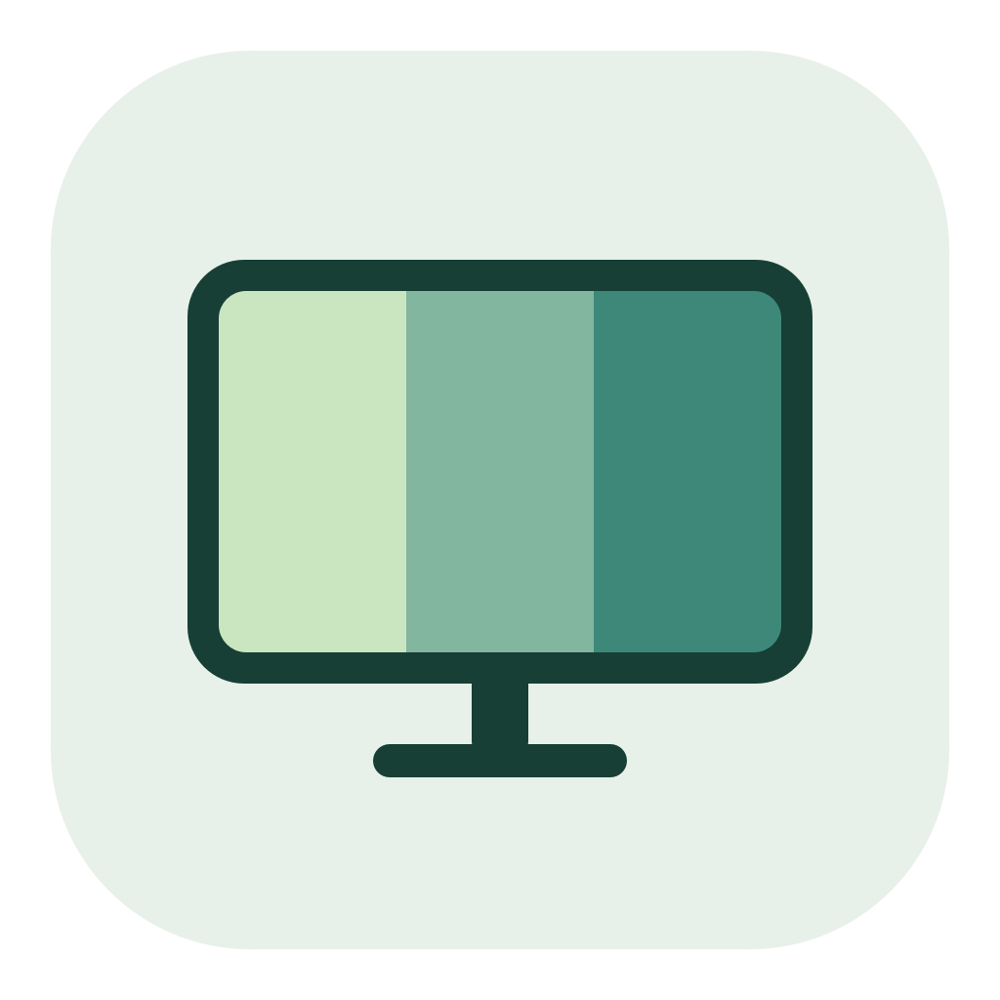
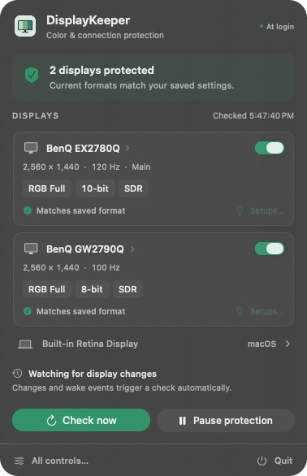
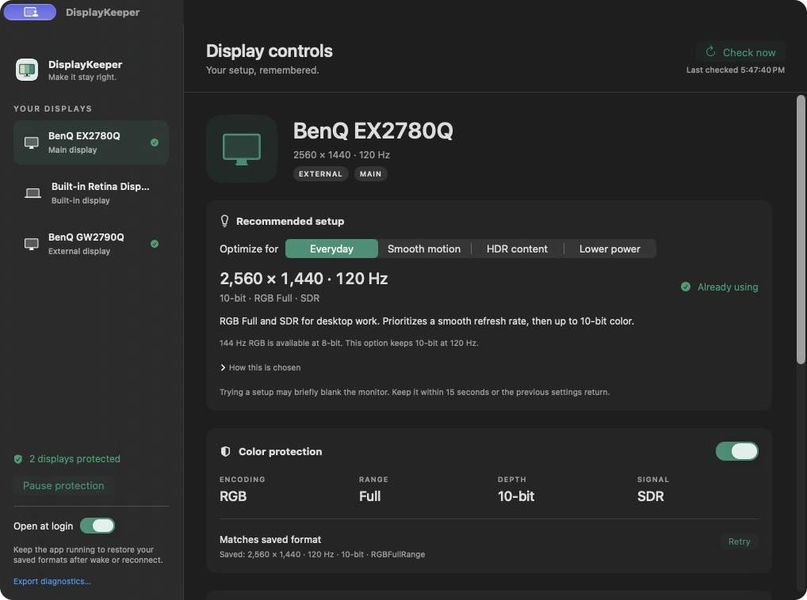

<p align="center">
  
</p>

# DisplayKeeper

A native macOS menu-bar app that remembers your monitor's color format and restores it when macOS changes it.

Choose a working format once and enable protection for that display.

<p align="center">
  
</p>

## Why I built it

After upgrading from macOS 26 to 27, my BenQ EX2780Q and GW2790Q started coming back washed out after restarts. The Mac, cables, and monitor settings were unchanged. Logs from the original workaround repeatedly captured the connections reverting to **limited-range YCbCr**; restoring their known-good **full-range RGB** formats brought the picture back.

Those logged corrections kept the same resolution, refresh rate, bit depth, and SDR state. The change was in color encoding and range. A [range mismatch can make the image look faded](https://betterdisplay.pro/guide/tutorials/fix-output-range-and-color-mode/), although correctly interpreted limited-range output is valid. The exact change inside macOS 27 that triggered this on my setup remains unconfirmed.

The first workaround was a script that checked every ten seconds, leaving a delay before correction and a visible monitor resync. DisplayKeeper replaces that polling loop with a native app that reacts to display events, remembers the working format, and shows whether it is still active. A correction can still briefly blank the monitor.

## What it does

- **Color protection:** remembers resolution, refresh rate, encoding, range, bit depth, and SDR/HDR per monitor. Shows whether the current signal matches.
- **Recommended setups:** Everyday, Smooth motion, HDR content, and Lower power options, with the tradeoffs explained. Uses modes advertised by the current connection.
- **Display controls:** resolution, refresh rate, connection format, HDR, rotation, main display, and native Apple brightness where supported.
- **Recoverable changes:** try a mode for 15 seconds. Keep it or let the previous settings return.
- **Menu-bar status:** check now, pause/resume, per-monitor protection, and open at login. No persistent Dock icon.



## Build and install

Requires macOS 14 or later and Apple developer tools with **Swift 6**. Install Xcode Command Line Tools with `xcode-select --install` if needed.

```sh
git clone https://github.com/mkrs2404/DisplayKeeper.git
cd DisplayKeeper
bash build.sh
mkdir -p ~/Applications
ditto dist/DisplayKeeper.app ~/Applications/DisplayKeeper.app
open ~/Applications/DisplayKeeper.app
```

The build produces a locally ad-hoc-signed app; it is not notarized. Quit an existing copy before replacing it.

1. Select a monitor and check that its picture and current format look right.
2. Enable **Color protection** to remember that format. Protection starts off for new displays.
3. Enable **Open at login** from the installed copy.

Use **Setups…** to compare recommendations. Browsing them does not change the monitor; **Try this setup…** starts the confirmation countdown. Closing the window leaves protection running. **Quit** stops it.

## Compatibility and limits

Tested on an Apple Silicon Mac running macOS 27.0.1 with BenQ EX2780Q and GW2790Q monitors. Other hardware and older supported macOS versions need testing.

- Connection controls use private `CADisplay` APIs; HDR and rotation use private `MonitorPanel` APIs. Runtime signatures are checked and unsupported controls are withheld, but macOS updates can break compatibility.
- Protection begins when the app runs. It cannot control FileVault or pre-login display negotiation, and a signal change can still briefly blank the monitor. Full restart and sleep/wake acceptance testing remains outstanding.
- Recommendations concern the connection format, not color calibration. Known panel metadata is included for the two BenQ models; unknown monitors use driver information and show its limits.
- DDC brightness/contrast, virtual displays, custom EDID, and custom HiDPI modes are not included. Existing macOS display modes are available. Arrangement and profile editing open macOS settings.
- Use one app to manage automatic color-format restoration. A separate DDC utility can handle hardware brightness and contrast.

## How it runs

Display and wake events trigger checks, with a short, bounded set of follow-up checks during startup and wake. There is no repeating configuration poll. Correction attempts are rate-limited; persistent failures suspend retries and appear in the UI.

Recommendations run locally and are cached. No account, cloud service, analytics, or network access is required. In one 60-second background sample on an M4 Max, version 0.3.0 averaged 0.031% of one CPU core with a physical memory footprint of about 63 MiB. This is a short observation, not a battery-life or wattage benchmark.

Settings and pending recovery state are stored in `~/Library/Application Support/DisplayKeeper/settings.json`.

## Development

```sh
bash scripts/run-core-tests.sh
dist/DisplayKeeper.app/Contents/MacOS/DisplayKeeper --diagnose
```

The core suite covers mode matching, bounded retries, policy persistence, status reporting, and recommendation choices. It runs with Command Line Tools without requiring XCTest. `--diagnose` reads display state without loading or enforcing saved policies. Diagnostic output contains display identifiers; review it before sharing.

| Directory | Purpose |
| --- | --- |
| `Sources/DisplayCore` | Protection policy, health state, and recommendations |
| `Sources/DisplayNative` | Objective-C bridge to macOS display interfaces |
| `Sources/DisplayKeeper` | SwiftUI/AppKit interface and event handling |
| `Tests/DisplayCoreTests` | Core behavior tests |
| `packaging` | App metadata and original icon assets |

Bug reports should include the macOS version, Mac and monitor models, connection type, and expected versus observed behavior.

## License

[MIT](LICENSE). Independent implementation; no BetterDisplay code or assets are included. [Rea](https://github.com/morluto/rea) was used during development and is not a runtime dependency.
